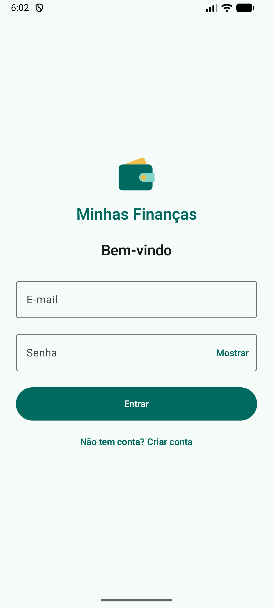
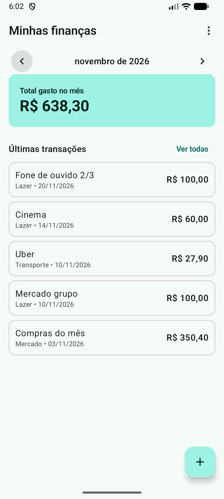
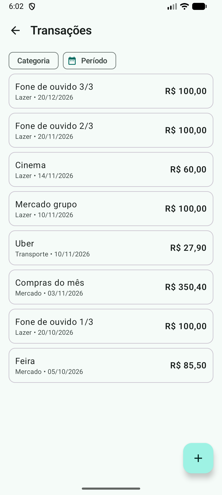
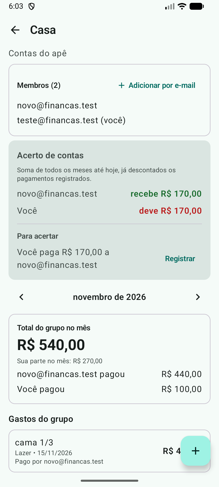
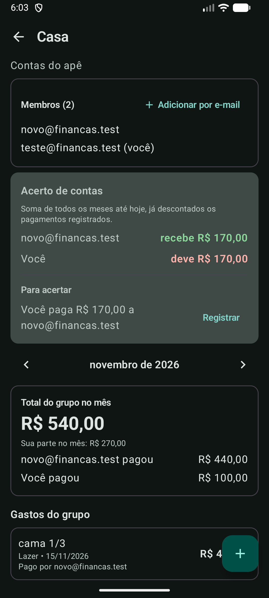

# Minhas Finanças (Android)

Personal finance app for Android, written in Kotlin with Jetpack Compose. Track monthly expenses, split shared bills in groups and see who owes whom. It talks to its own REST API: [financas-api](https://github.com/DevTonyz/financas-api).

<p>
  
  
  
  
  
</p>

## Features

- **Monthly dashboard:** total spent and latest expenses, with month navigation.
- **Expenses:** create, edit and delete, filter by category or period, infinite scroll. Credit purchases in installments, with "only this one / this and the next ones / the whole purchase" when editing or deleting.
- **Categories:** each user manages their own list.
- **Groups (shared accounts):** add members by e-mail, track a running balance across months, register payments between members and get settle-up suggestions. Each member has a join date, so newcomers never split expenses from before they joined.
- Light and dark theme, own icon, empty states, password visibility toggle, landscape support.
- Session handling: an expired token sends the user back to login automatically.

## Stack

Kotlin · Jetpack Compose (Material 3) · Navigation Compose · ViewModel + StateFlow · Retrofit + Gson · minSdk 24, targetSdk 36

## Running

1. Start the API on `http://localhost:8080` (see the [financas-api README](https://github.com/DevTonyz/financas-api#running-locally)).
2. Open this project in **Android Studio** and run it on an **emulator**. The app reaches the API at `http://10.0.2.2:8080/`, which is the emulator's alias for the host machine (`network/RetrofitClient.kt`).
3. Create an account in the app, or log in with an existing one.

Command-line build:

```bash
./gradlew assembleDebug
```

## Architecture

One activity, Compose screens and a small layered structure (screen → ViewModel → repository → API):

```
com.antony.financasapp/
├─ FinancasApplication.kt   creates the session, the API client and the repositories once (by lazy)
├─ MainActivity.kt          only sets the theme and calls AppNavHost()
├─ core/                    SessionManager (token in SharedPreferences) and SessionEvents (401 → login)
├─ data/                    XxxRepository: the only layer that calls the API; returns Resultado<T>
├─ dto/                     classes that mirror the API JSON
├─ network/                 ApiService (Retrofit routes), RetrofitClient, AuthInterceptor (Bearer token, 401)
└─ ui/
   ├─ theme/                FinancasTheme: colors (light/dark) and typography
   ├─ Componentes.kt        shared pieces: logo, password field, empty state
   ├─ Formatacao.kt         currency (R$), month names, date conversion
   ├─ navigation/           routes and NavHost
   └─ <screen>/             TelaXxx.kt (stateless Composable) + XxxViewModel.kt (StateFlow<XxxUiState>)
```

- Screens read state with `collectAsStateWithLifecycle()` and send actions to the ViewModel; they hold no business logic.
- Repositories expose a `mudancas` counter, so screens that show expenses reload by themselves after any create/edit/delete.
- Dates are kept as `yyyy-MM-dd` strings (no `java.time`, because of minSdk 24) and shown as `dd/MM/yyyy`.
